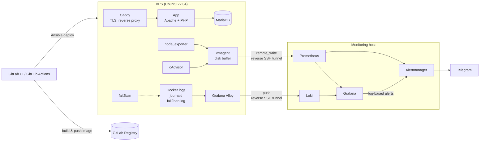

# infra-showcase

Инфраструктура небольшого продакшен-проекта: Dockerized PHP-приложение на VPS,
CI/CD, мониторинг, централизованное логирование, алертинг и hardening.
Всё описано как код и разворачивается из этого репозитория.

> Конфиги взяты из реально работающей системы. Секреты, IP и домены заменены
> на переменные и плейсхолдеры (`*.example`, `vps.example.com`, `app.example.com`).

## Архитектура



Хост мониторинга не имеет публичного адреса. Связь с ним идёт через
reverse SSH-туннели, которые он сам поднимает к VPS. Ни один порт мониторинга
не открыт в интернет.

## Стек

| Область | Инструменты |
|---|---|
| Контейнеры | Docker, Docker Compose, GitLab Container Registry |
| CI/CD | GitLab CI, GitHub Actions, Ansible |
| Метрики | Prometheus, vmagent (VictoriaMetrics), node_exporter, cAdvisor |
| Логи | Grafana Loki, Grafana Alloy |
| Визуализация и алерты | Grafana, Alertmanager → Telegram |
| Прокси и TLS | Caddy (автоматический Let's Encrypt) |
| Безопасность | SSH только по ключам, fail2ban, ограниченные SSH-ключи |
| ОС | Ubuntu, systemd |

## Структура

```
app/                    Dockerfile, docker-compose, Caddyfile, systemd-таймеры
ansible/                плейбук деплоя приложения
ci/                     пайплайны: сборка образа, линт + деплой, GitHub Actions
monitoring-central/     Prometheus, Grafana, Loki, Alertmanager, дашборды, правила
  lan-scanner/          самописный экспортёр устройств в LAN (textfile collector)
monitoring-agent/       то, что стоит на VPS: vmagent, Alloy, экспортёры
  security/             fail2ban, sshd hardening, пример ограниченного ключа
tunnels/                systemd-юниты SSH-туннелей
```

## Ключевые решения

**Метрики не теряются при недоступности хоста мониторинга.**
vmagent на VPS собирает метрики локально и отправляет их через `remote_write`.
Пока хост мониторинга недоступен, данные копятся на диске, а после восстановления
связи досылаются.

**Объём метрик снижен примерно в 7 раз.**
В vmagent настроен relabeling: отбрасываются неиспользуемые серии и лейблы
(см. `monitoring-agent/vmagent/scrape.yml`).

**Логи с разбором времени.**
Alloy собирает логи Docker-контейнеров, journald и fail2ban. Для fail2ban
временная метка парсится из строки лога с учётом часового пояса сервера,
так что в Loki события лежат с реальным временем, а не со временем чтения.

**Безопасность туннелей.**
Ключ, которым хост мониторинга подключается к VPS, ограничен:
`restrict,port-forwarding,permitlisten=...,command="/bin/false"`.
Через него нельзя получить shell, можно только открыть разрешённые порты
(см. `monitoring-agent/security/tunnel-authorized_keys.example`).

**Алерты по логам.**
Правило в Grafana считает баны fail2ban в Loki и отправляет их в Alertmanager.
Отдельный маршрут группирует алерты по IP: одно сообщение на один бан,
без повторов и без resolved-шума.

## CI/CD

1. `ci/gitlab-ci.image-build.yml`: сборка образа, push в GitLab Registry,
   обновление контейнера на сервере.
2. `ci/gitlab-ci.app-deploy.yml`: `php -l` по всем файлам, затем деплой через Ansible.
3. `ci/github-actions/`: тот же деплой на GitHub Actions.

Переменные задаются в настройках CI:

| Переменная | Назначение |
|---|---|
| `SSH_KEY` / `SSH_PRIVATE_KEY` | ключ деплоя (base64) |
| `DEPLOY_HOST` | адрес сервера |
| `DEPLOY_PATH` | каталог проекта на сервере |
| `APP_REPO` | репозиторий приложения |

## Запуск

```bash
# хост мониторинга
cd monitoring-central
cp .env.example .env               # задать пароль Grafana
echo "<bot token>" > telegram_token
docker compose up -d

# туннели
cp tunnels/*.service ~/.config/systemd/user/
systemctl --user daemon-reload
systemctl --user enable --now vps-tunnel vps-metrics-tunnel

# VPS: агенты
cd monitoring-agent && docker compose up -d
cd alloy && docker compose up -d

# VPS: приложение
cd app && cp .env.example .env && docker compose up -d
```

## Дальше

- [ ] перенести приложение в Kubernetes (k3s), Helm-чарт
- [ ] инфраструктура VPS через Terraform
- [ ] роли Ansible для агентов мониторинга и hardening
